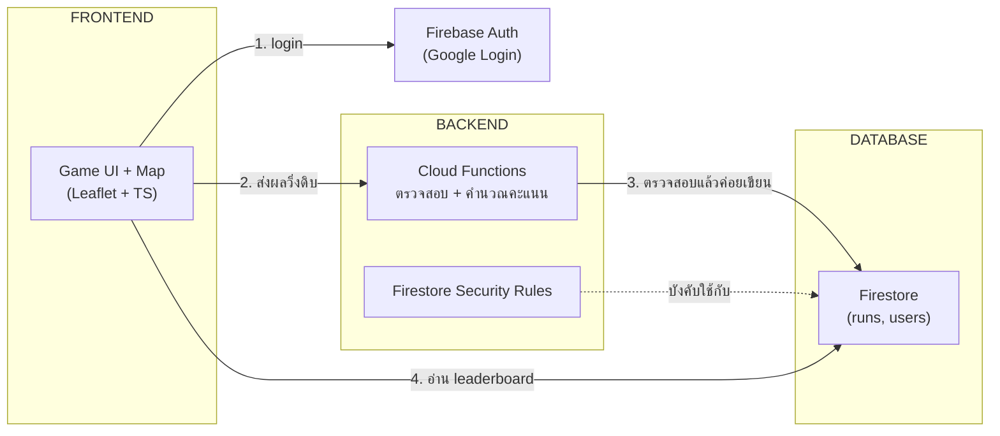
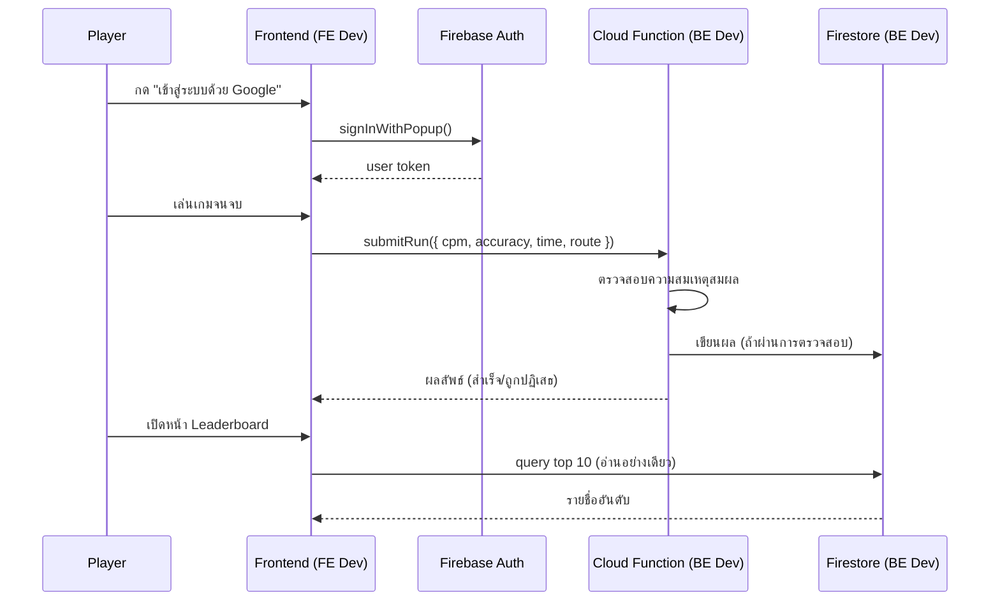

# Metro Typing Thailand — โครงสร้างทีมและหน้าที่ (FE / BE แยกจริง)

> อัปเดตจากแผนเดิม: เพิ่ม **Cloud Functions** เป็นชั้นกลางระหว่าง FE กับ Firestore
> เพื่อไม่ให้ FE เขียนข้อมูลลง database ตรง ๆ (กันโกงคะแนน + แยกความรับผิดชอบชัดเจน)

---

## สถาปัตยกรรมหลังแยกแล้ว

**กติกาสำคัญ:** FE **ห้าม** เขียน Firestore ตรง ๆ เด็ดขาด (ยกเว้นอ่านอย่างเดียว) — การเขียนทุกครั้งต้องผ่าน Cloud Function เท่านั้น

---

## แบ่งงานตามชั้นระบบ (Layer-based)

| ชั้น | เทคโนโลยี | ใครดูแล | หน้าที่หลัก |
|---|---|---|---|
| **Frontend** | TypeScript, Leaflet.js, HTML/CSS | FE Dev | เกม, แผนที่, UI, เรียก Auth SDK, เรียก Cloud Function |
| **Backend** | Firebase Cloud Functions (Node.js/TS) | BE Dev | ตรวจสอบความถูกต้องของผล, คำนวณ/บันทึกคะแนน, กันโกง |
| **Database** | Firestore | BE Dev (ร่วม) | ออกแบบ schema, เขียน Security Rules, สร้าง index |
| **Auth** | Firebase Authentication | BE Dev (setup) / FE Dev (integrate) | ตั้งค่า Google provider, จัดการ token |
| **Infra/DevOps** | Firebase Hosting / Vercel, GitHub Actions | DevOps | CI/CD, environment variables, deploy |

---

## หน้าที่แยกตามคน (Role-based)

### 1. Frontend Developer
**รับผิดชอบ:** ทุกอย่างที่ผู้เล่นเห็นและโต้ตอบด้วย

- [ ] สร้าง/ดูแล `game.ts` (engine พิมพ์ที่มีอยู่แล้ว)
- [ ] เชื่อม Leaflet map กับพิกัดสถานีจริง (เฟส 1-2)
- [ ] ทำปุ่ม Google Sign-In เรียก Firebase Auth SDK (`signInWithPopup`)
- [ ] เรียก Cloud Function ส่งผลวิ่งหลังจบเกม (ห้ามเขียน Firestore ตรง)
- [ ] ดึงข้อมูล leaderboard มาแสดงผล (อ่านอย่างเดียว)
- [ ] ทำ UI responsive สำหรับมือถือ
- [ ] จัดการ error state (login ล้มเหลว, เน็ตหลุด, ส่งผลไม่สำเร็จ)

**ไม่ต้องรู้:** วิธีเขียน Firestore Security Rules, การ deploy Cloud Function

---

### 2. Backend Developer
**รับผิดชอบ:** ความถูกต้องและความปลอดภัยของข้อมูล

- [ ] เขียน Cloud Function `submitRun()` — รับผลดิบจาก FE, ตรวจสอบความสมเหตุสมผล (เช่น cpm ต้องไม่เกินขีดจำกัดทางกายภาพ, เวลาต้องตรงกับจำนวนสถานี), แล้วค่อยเขียนลง Firestore
- [ ] ออกแบบ Firestore schema (`runs`, `users` collections)
- [ ] เขียน Firestore Security Rules (อ่านได้ทุกคน, เขียนได้เฉพาะผ่าน Function)
- [ ] เขียน Cloud Function `getLeaderboard()` (หรือใช้ query ตรงจาก FE ถ้า rules อนุญาตอ่าน)
- [ ] สร้าง Firestore index สำหรับ query แบบ filter+sort (เช่น กรองตามสาย + เรียงตาม cpm)
- [ ] ทดสอบ anti-cheat logic ด้วยเคสโกง (ส่งค่าที่ผิดปกติ)

**ไม่ต้องรู้:** Leaflet.js, CSS ของเกม

---

### 3. DevOps / Infra
**รับผิดชอบ:** ทำให้ระบบ deploy ได้จริงและปลอดภัย

- [ ] ตั้งโปรเจกต์ Firebase (แยก dev/production environment)
- [ ] ตั้งค่า GitHub Actions: build → test → deploy อัตโนมัติเมื่อ push ขึ้น `main`
- [ ] จัดการ environment variables/secrets (`.env`, Firebase config) ไม่ให้หลุดขึ้น git
- [ ] ตั้งค่า custom domain + HTTPS
- [ ] Monitor usage (Firebase quota ฟรี ไม่เกิน limit)

*(ถ้าทีมเล็ก บทบาทนี้มักรวมกับ Backend Developer)*

---

### 4. QA / Tester
**รับผิดชอบ:** ทดสอบก่อนปล่อยจริง

- [ ] ทดสอบ login/logout/refresh หน้าเว็บ
- [ ] ทดสอบเกมพิมพ์ครบทุกโหมด (จบสาย, สลับทิศ, กำหนดเส้นทาง, สุ่ม)
- [ ] ทดสอบ edge case: พิมพ์เร็วผิดปกติ, ปิดเน็ตกลางเกม, เปิดสองแท็บพร้อมกัน
- [ ] ทดสอบบนมือถือจริง (iOS/Android, เบราว์เซอร์ต่างกัน)
- [ ] เช็ก checklist production ทั้งหมดก่อนปล่อย

*(ถ้าทีมเล็ก คนอื่นในทีมช่วยกันเทสได้)*

---

### 5. UI/UX Designer *(ถ้ามี)*
- [ ] ออกแบบหน้า Leaderboard ให้อ่านง่าย
- [ ] ออกแบบ state ต่าง ๆ (loading, error, empty leaderboard)
- [ ] เลือกสไตล์แผนที่ (สี, tile layer) ให้เข้ากับธีมเกม

---

## Data flow แบบละเอียด (ใครแตะจุดไหน)

---

## สรุป: ใครห้ามทำอะไร

| กฎ | เหตุผล |
|---|---|
| FE ห้ามเขียน Firestore ตรง | กันโกงคะแนน, บังคับผ่านการตรวจสอบทุกครั้ง |
| BE ไม่ยุ่งกับ UI/CSS/Leaflet | แยกความรับผิดชอบ, แก้ bug ง่ายขึ้น |
| Security Rules ต้อง deny เขียนจาก client โดยตรง | เป็นด่านสุดท้ายกันโกง แม้ Cloud Function จะพลาด |
| Secrets/API keys ห้าม commit ขึ้น git | ป้องกันคนอื่นยิง Firebase quota ของเราหมด |

---

*เอกสารนี้ต่อยอดจาก `metro-typing-blueline-roadmap.md` — ใช้คู่กันได้: อันนั้นบอก "ทำอะไรเมื่อไหร่" (ตามเฟส) อันนี้บอก "ใครทำ" (ตามบทบาท)*
