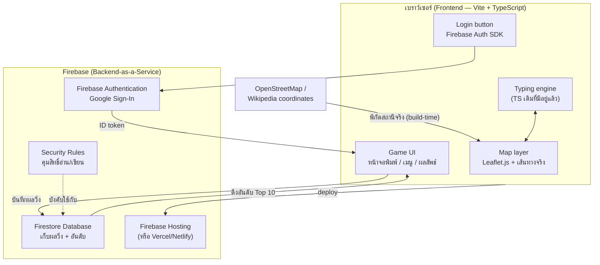
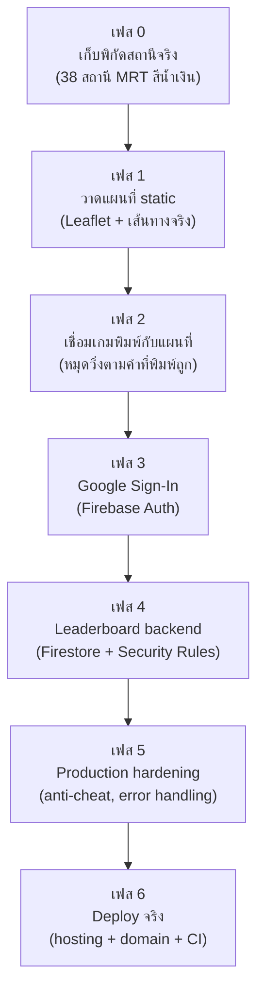

# Metro Typing Thailand — MRT สายสีน้ำเงิน (Real Map Edition)
### แผนพัฒนาตั้งแต่เริ่มต้นจนถึง Production

> ตัวอย่างนี้ทำเฉพาะ **MRT สายสีน้ำเงิน** (38 สถานี) ก่อน เพื่อใช้เป็นแม่แบบสำหรับขยายไปสายอื่นทีหลัง
> รวมระบบ **Login ผ่าน Google** และ **Leaderboard จัดอันดับ** เข้าไปในแผนตั้งแต่ต้น เพราะสองอย่างนี้ต้องมี backend/database ซึ่งกระทบสถาปัตยกรรมทั้งหมด

---

## 1. ภาพรวมสถาปัตยกรรม (Production)



**สรุปสั้น ๆ:** ฝั่งเบราว์เซอร์ยังเป็นแอปเดิม (TypeScript + Leaflet) แต่เพิ่ม **Firebase** เข้ามาเป็น backend สำเร็จรูป — ไม่ต้องเขียน server เอง ไม่ต้องดูแล database เอง เหมาะกับโปรเจกต์เดี่ยว/ขนาดเล็กที่มี Google login + leaderboard

---

## 2. ทำไมเลือก Firebase (แทนเขียน backend เอง)

| เกณฑ์ | Firebase | เขียนเอง (Node + Express + Postgres) |
|---|---|---|
| เวลาที่ใช้ setup | ~1-2 ชม. | หลายวัน |
| Google Login | มีให้ในตัว (`signInWithPopup`) | ต้อง implement OAuth2 flow เอง |
| ค่าใช้จ่ายเริ่มต้น | ฟรี (Spark plan เพียงพอสำหรับ hobby project) | ต้องเช่า server/DB เอง |
| Leaderboard query | Firestore query + index ง่าย ๆ | ต้องเขียน API endpoint + SQL เอง |
| ต้อง maintain server ไหม | ไม่ต้อง | ต้อง |
| เหมาะกับ | โปรเจกต์เดี่ยว, MVP, งานอดิเรก | ระบบใหญ่ที่ต้อง custom logic ซับซ้อน |

**ข้อแนะนำ:** เริ่มด้วย Firebase ก่อน ถ้าโปรเจกต์โตขึ้นค่อยย้ายออกทีหลังก็ได้ (Firestore export ข้อมูลออกมาได้)

---

## 3. แผนพัฒนา 7 เฟส (Dev → Production)



---

### เฟส 0 — เก็บพิกัดสถานีจริง
**เป้าหมาย:** ได้ไฟล์ `blueline-stations.json` ที่มี `{ code, th, en, lat, lng }` ครบทั้ง 38 สถานี

- ดึงพิกัดจาก Wikipedia (ทำไปแล้วบางส่วน) หรือใช้ Overpass API ของ OpenStreetMap ดึงทั้งสายในคำสั่งเดียว จะเร็วและแม่นกว่า
- ตรวจสอบลำดับสถานีให้ตรงกับเส้นทางจริง (ท่าพระ → บางซื่อ → ลาดพร้าว → หัวลำโพง → ท่าพระ → หลักสอง)

**Deliverable:** `data/blueline-stations.json`

---

### เฟส 1 — วาดแผนที่ static (ยังไม่ผูกเกม)
**เป้าหมาย:** เห็นเส้นทาง MRT สีน้ำเงินจริงบนแผนที่สไตล์ขาว/เส้นโครงร่าง

- ใช้ **Leaflet.js** + tile layer แบบ minimal (เช่น CartoDB Positron)
- วาด `L.polyline()` ผ่านพิกัดสถานีจริงตามลำดับ
- ปักหมุด (`L.marker`) ที่แต่ละสถานี พร้อม popup ชื่อสถานี

**Deliverable:** หน้าเว็บที่โหลดแล้วเห็นแผนที่ + เส้นทางจริง ยังไม่มี input พิมพ์

---

### เฟส 2 — เชื่อมเกมพิมพ์กับแผนที่
**เป้าหมาย:** พอพิมพ์ชื่อสถานีถูก → หมุด "รถไฟ" เลื่อนไปสถานีถัดไปบนแผนที่จริง

- เอา `MetroTypingGame` class เดิม (จาก TypeScript project) มาต่อยอด
- เพิ่มเมธอด `moveTrainTo(station)` ที่สั่ง Leaflet marker เคลื่อนที่ (ใช้ interpolation ให้ราบรื่นได้)
- ซิงก์ progress bar เดิมกับตำแหน่งบนแผนที่

**Deliverable:** เกมเล่นได้ครบ พิมพ์ถูกแล้วเห็นรถไฟวิ่งจริงบนแผนที่ (ยังเล่นแบบไม่ login ได้)

---

### เฟส 3 — Google Sign-In
**เป้าหมาย:** ผู้เล่น login ด้วย Google ได้

**ขั้นตอนหลัก:**
1. สร้างโปรเจกต์ใน [Firebase Console](https://console.firebase.google.com)
2. เปิดใช้ **Authentication → Sign-in method → Google**
3. ติดตั้ง SDK: `npm install firebase`
4. เพิ่มปุ่ม "เข้าสู่ระบบด้วย Google" เรียก `signInWithPopup(auth, googleProvider)`
5. เก็บ `user.uid`, `user.displayName`, `user.photoURL` ไว้แสดงผล

**Deliverable:** ผู้เล่น login/logout ได้ เห็นชื่อ-รูปโปรไฟล์ตัวเองในเกม

> 💡 ไม่บังคับให้ login ก็ยังเล่นได้ — แค่ผลจะไม่ถูกบันทึกขึ้น leaderboard ถ้าไม่ login

---

### เฟส 4 — Leaderboard backend
**เป้าหมาย:** บันทึกผลการวิ่งแต่ละครั้ง และแสดงอันดับ Top 10

**Data model (Firestore collection `runs`):**
```json
{
  "userId": "firebase-uid-xxxx",
  "displayName": "Phakkapon P.",
  "line": "blue",
  "mode": "full",
  "route": "Lak Song -> Charan 13",
  "cpm": 187,
  "accuracy": 96,
  "timeSeconds": 142.3,
  "maxCombo": 34,
  "createdAt": "2026-08-12T10:30:00Z"
}
```

**งานที่ต้องทำ:**
- เขียนผลลง Firestore หลังจบเกม (`finishGame()` เดิม → เพิ่ม `saveRunToLeaderboard()`)
- Query อันดับ: `orderBy("cpm", "desc").limit(10)` (กรองตาม `line` + `mode` ได้)
- เขียน **Firestore Security Rules** กันคนอื่นแก้/ลบข้อมูลของคนอื่น:

```
rules_version = '2';
service cloud.firestore {
  match /databases/{database}/documents {
    match /runs/{runId} {
      allow read: if true;
      allow create: if request.auth != null
                    && request.resource.data.userId == request.auth.uid;
      allow update, delete: if false;
    }
  }
}
```

**Deliverable:** หน้า Leaderboard แสดงอันดับ 10 อันดับแรกต่อสาย/โหมด อัปเดตแบบเรียลไทม์ได้ถ้าต้องการ (`onSnapshot`)

---

### เฟส 5 — Production hardening
สิ่งที่มักถูกลืมตอนทำ MVP แต่จำเป็นก่อนปล่อยจริง:

- **Anti-cheat เบื้องต้น:** ตรวจสอบฝั่ง client ว่า `cpm`/`timeSeconds` สมเหตุสมผล (เช่น cpm > 2000 = ปฏิเสธ ไม่บันทึก) — ป้องกันคนแก้ค่าใน DevTools แบบหยาบ ๆ (การป้องกันเต็มรูปแบบต้องมี Cloud Function ตรวจสอบฝั่ง server)
- **Error handling:** ถ้า Firestore เขียนล้มเหลว (เน็ตหลุด) ต้องไม่ทำให้เกม crash — เก็บผลไว้ retry
- **Rate limiting:** จำกัดจำนวนครั้งที่บันทึกผลต่อนาที (กัน spam leaderboard)
- **Environment variables:** แยก Firebase config ของ dev/production ไม่ hardcode API key ลง repo (ใช้ `.env` + `.gitignore` ที่ตั้งไว้แล้ว)
- **Analytics (ถ้าต้องการ):** Firebase Analytics ดูว่าคนเล่นสายไหน โหมดไหนบ่อยสุด

---

### เฟส 6 — Deploy จริง
**ตัวเลือก hosting (ฟรีทั้งคู่สำหรับโปรเจกต์เดี่ยว):**

| | Firebase Hosting | Vercel / Netlify |
|---|---|---|
| ข้อดี | อยู่ ecosystem เดียวกับ Auth/Firestore, deploy คำสั่งเดียว | CI/CD สวยงาม, preview URL ทุก PR |
| คำสั่ง deploy | `firebase deploy` | เชื่อม GitHub แล้ว auto-deploy |

**ขั้นตอน:**
1. `npm run build` (จาก TypeScript project ที่มีอยู่แล้ว)
2. ตั้งค่า custom domain (ถ้ามี)
3. เชื่อม GitHub Actions ให้ build + deploy อัตโนมัติทุกครั้งที่ push ขึ้น `main`
4. เปิด HTTPS (auto ทั้งสอง provider)

**Deliverable:** ลิงก์ production จริงที่ใครก็เข้าเล่นได้ พร้อม login + leaderboard ใช้งานได้จริง

---

## 4. โครงสร้างโฟลเดอร์ที่แนะนำ (ต่อยอดจากโปรเจกต์ TS เดิม)

```
metro-typing-ts/
├── src/
│   ├── data/
│   │   └── blueline-stations.json   ← เฟส 0
│   ├── map/
│   │   └── mapController.ts         ← เฟส 1-2 (Leaflet wrapper)
│   ├── auth/
│   │   └── firebaseAuth.ts          ← เฟส 3
│   ├── leaderboard/
│   │   └── firestoreLeaderboard.ts  ← เฟส 4
│   ├── game.ts                      ← เกมเดิม (มีอยู่แล้ว)
│   └── firebaseConfig.ts            ← เก็บ config (ไม่ commit ค่า production)
├── firestore.rules                  ← เฟส 4
├── index.html
├── .env.example
└── package.json
```

## 5. Checklist ก่อนขึ้น production

- [ ] พิกัดสถานีครบ 38 สถานี ตรวจสอบความถูกต้องแล้ว
- [ ] แผนที่แสดงเส้นทางตรงกับความจริง
- [ ] เกมพิมพ์ผูกกับแผนที่ทำงานลื่นไหล
- [ ] Google Sign-In ทดสอบทั้ง login/logout/refresh หน้า
- [ ] Firestore Security Rules ป้องกันการแก้ข้อมูลคนอื่น
- [ ] Leaderboard query เร็ว (มี index ที่ถูกต้อง)
- [ ] `.env` ไม่หลุดขึ้น git (เช็ก `.gitignore`)
- [ ] ทดสอบบนมือถือ (responsive)
- [ ] Deploy ขึ้น hosting จริง + HTTPS

---

*เอกสารนี้ใช้ MRT สายสีน้ำเงินเป็นตัวอย่างต้นแบบ — พอทำครบทุกเฟสแล้ว การเพิ่มสายสีม่วง/BTS จะเหลือแค่เพิ่มไฟล์ `.json` พิกัดสถานีอีกสาย โครงสร้างที่เหลือ (แผนที่ / login / leaderboard) ใช้ซ้ำได้ทันที*
